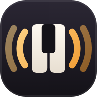
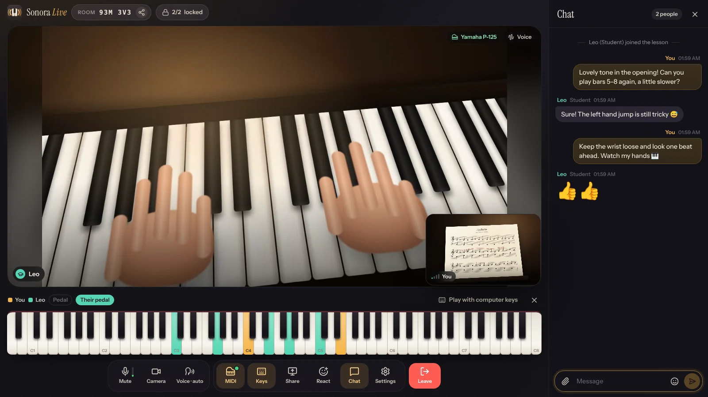
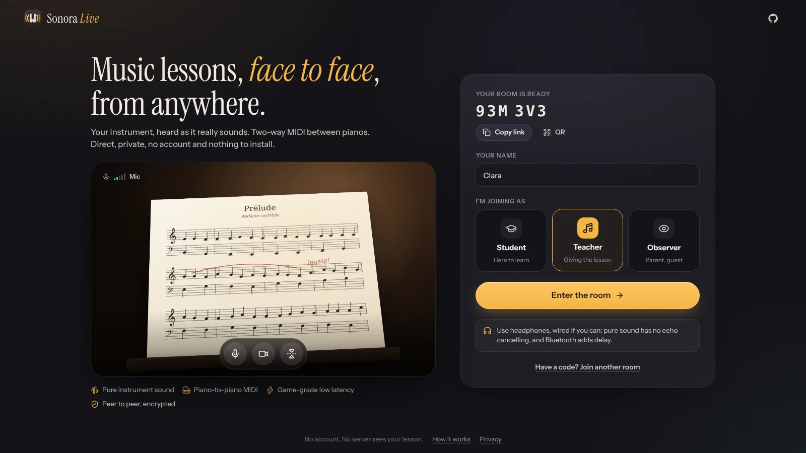
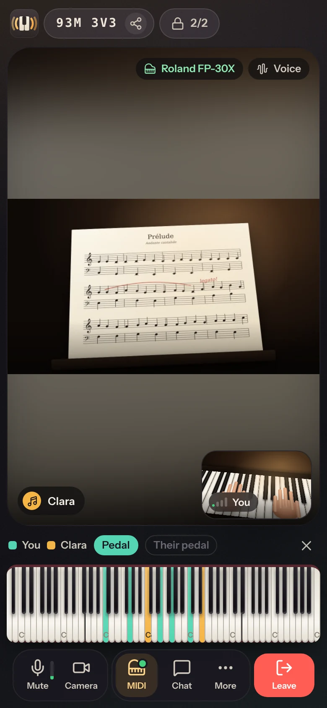
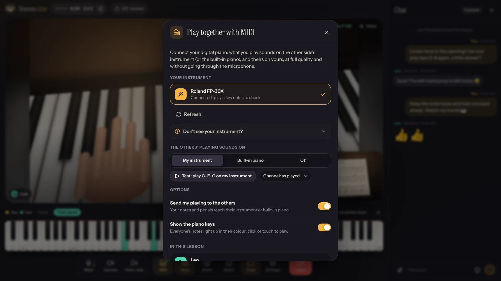
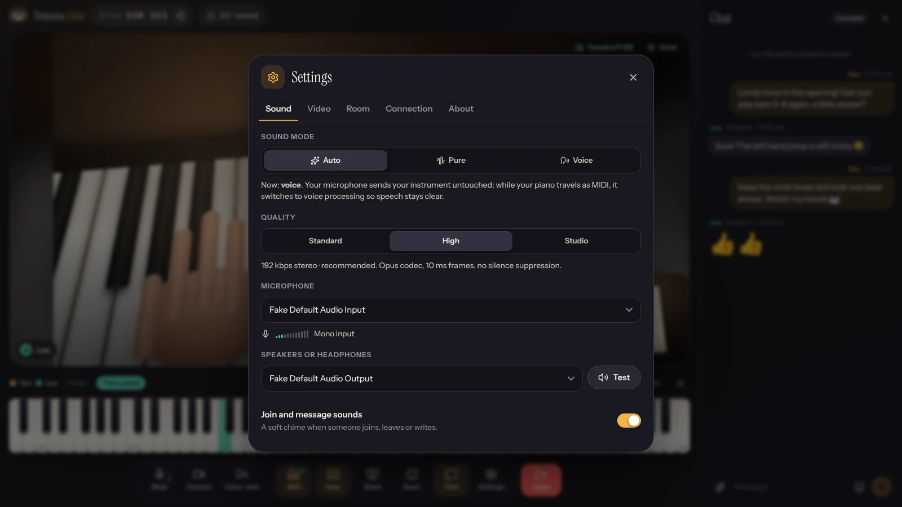
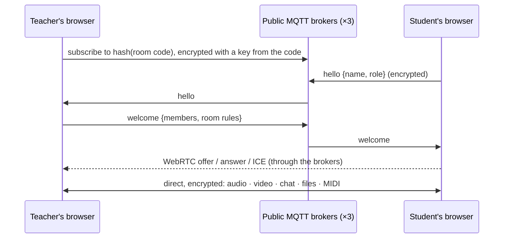

<p align="center">
  
</p>

<h1 align="center">Sonora Live</h1>

<p align="center">
  <b>Remote music lessons that sound like the room.</b><br>
  Peer-to-peer video, pure unprocessed instrument sound, and two-way MIDI between the teacher's and the
  student's pianos, in the browser. No account, no install, no server in the middle.
</p>

<p align="center">
  <a href="https://mayerwin.github.io/sonora-live/"><b>▶&nbsp;Open Sonora Live</b></a>
  &nbsp;·&nbsp;
  <a href="#features">Features</a>
  &nbsp;·&nbsp;
  <a href="#play-together-over-midi">MIDI</a>
  &nbsp;·&nbsp;
  <a href="#works-everywhere">Platforms</a>
  &nbsp;·&nbsp;
  <a href="#how-it-works">How it works</a>
  &nbsp;·&nbsp;
  <a href="#privacy">Privacy</a>
</p>

<p align="center">
  <a href="https://github.com/mayerwin/sonora-live/actions/workflows/ci.yml"></a>
  <a href="https://github.com/mayerwin/sonora-live/actions/workflows/pages.yml"></a>
  <a href="LICENSE"></a>
  
</p>

<p align="center">
  
</p>

---

Video-call apps are built for speech. Their noise suppression decides that a sustained chord is noise, their echo
cancelling chops the decay of a note, automatic gain flattens a crescendo, and the sound arrives in mono at a
fraction of the bitrate music needs. Teachers end up hunting for "original sound" switches that reset every call.

**Sonora Live is built for the lesson.** Open the page and your room exists. Send the 6-character code or the link,
and your student picks *Student*, you pick *Teacher*, and you are face to face, hearing each other's instruments the
way they actually sound. With a digital piano on each side, the notes themselves travel: what the student plays
sounds on the teacher's piano, and what the teacher plays sounds on the student's.

## Features

### Sound that is the instrument

- **Pure sound by default**: no noise suppression, no echo cancellation, no automatic gain, stereo when your
  microphone or interface has it. Every pedal, pianissimo and long decay arrives as played, the way
  [Cleanfeed](https://cleanfeed.net) treats broadcast audio.
- **Opus tuned for music**: 192 kbps stereo by default (96 to 320 kbps), full band, **10 ms frames** instead of
  20 (one frame less delay at each end), no silence suppression that would cut a quiet sustained note, and
  in-band error correction against packet loss.
- **Sound never waits for the picture**: audio and video are not lip-synced on purpose. Lip sync holds the sound back
  until the slower video has been decoded; here the sound plays the instant it arrives.
- **Smart voice mode**: on *Auto*, while your piano travels as MIDI, your microphone switches to speech processing,
  so talking stays clear and the piano is not sent twice. It switches back by itself.
- **Clip warning**: with automatic gain off, the meter tells you when a forte passage overloads your microphone.

### Play together over MIDI

- **Tap MIDI, pick your piano, done.** USB instruments, system MIDI ports, and **Bluetooth LE MIDI instruments
  connected straight from the browser** (no pairing in the system settings).
- What you play sounds **on the other side's instrument**: notes, velocity, sustain, sostenuto and soft pedals.
- **No instrument on the other side?** It plays on the **built-in concert grand**: a Steinway sampled in four velocity
  layers, with real damper behaviour (the top octave and a half rings on, as on a grand), half-pedalling,
  re-striking, a touch of concert-hall reverb, and a limiter so a fortissimo chord with the pedal down never
  distorts.
- **An 88-key display** shows everyone's notes and pedals in their colour. Click, touch, or use the computer keyboard
  (A W S E D… like a DAW) to play to the other side without an instrument.
- **Loss-proof**: MIDI travels unordered and unacknowledged like game inputs, with redundancy and state snapshots, so a
  lost packet never leaves a note hanging. **Loop-proof**: instruments that echo what they receive (MIDI thru) are
  recognised, so the teacher never hears their own notes back.
- Channel selection and a *Test* button that plays C–E–G on your instrument, for the pianos that listen on one
  channel only.

### Rooms in one tap

- A **room is created the moment you open the page**, with a 6-character code (no look-alike characters), a link, a
  QR code and the phone's share sheet.
- **Locked to 2 people by default** (adjustable from 2 to 12). Anyone else **knocks**; everyone inside sees who it is
  and can let them in with one click.
- **Join notifications**, on by default: a soft chime, a toast, a system notification when the tab is in the
  background (the browser asks for it when you open a room or copy its link), a counter in the tab title, and a
  vibration on phones.
- **Roles**: Student, Teacher, Observer (a parent, a guest). Each has its colour on the keys and in the chat.
- **No host**: anyone can leave or reload without ending the lesson. A reload rejoins as the same person, even in a full
  room, and two people opening the same link at the same moment always find each other.

### Everything a lesson needs

- **Chat** with the full emoji picker, links, typing indicator, and **files sent directly** (sheet music as PDF,
  MusicXML or a photo, up to 50 MB): drop them on the chat or paste a picture.
- **Reactions** (👏 🎵 🔥…) floating over the video.
- **Share your screen** (a score editor, a PDF) or **add a second camera** pointed at the keys. Or scan the room's QR
  code with a phone and use it as an overhead camera.
- **Connection panel**: the path (direct or relayed), round trip, estimated delay of the other side's sound, jitter
  buffer, bitrate, codec, packet loss, resolution.
- **Installable** as an app on every platform (it then opens in its own window and starts offline), screen kept awake
  during the lesson, preferences remembered.
- **In English and French** (*en français*), following the browser's language, with a switch in the lobby and in
  Settings → General. Emoji search and note names follow too (do3 for middle C in French).
- **Always the latest version**, with no refresh to force: a new release loads by itself in the lobby, and never
  interrupts a lesson (it waits until you are back in the lobby).

<table>
  <tr>
    <td width="66%"></td>
    <td></td>
  </tr>
  <tr>
    <td></td>
    <td></td>
  </tr>
</table>

## Works everywhere

Open **[mayerwin.github.io/sonora-live](https://mayerwin.github.io/sonora-live/)** in any modern browser. Video, pure
sound, chat, and *hearing* the other side's MIDI on the built-in piano work everywhere. Connecting your own instrument
depends on what the browser allows:

| | Video & pure sound | USB MIDI instrument | Bluetooth MIDI instrument |
|---|:---:|:---:|:---:|
| **Windows** · Chrome, Edge | ✅ | ✅ | ✅ in the browser, or with [Perfect Bluetooth MIDI](https://github.com/mayerwin/Perfect-Bluetooth-MIDI-For-Windows) |
| **macOS** · Chrome, Edge | ✅ | ✅ | ✅ in the browser, or paired in Audio MIDI Setup |
| **Android** · Chrome | ✅ | ✅ with a USB OTG adapter | ✅ in the browser |
| **ChromeOS** | ✅ | ✅ | ✅ in the browser |
| **Linux** · Chrome, Edge | ✅ | ✅ | ✅ paired with BlueZ (or Web Bluetooth flag) |
| **Firefox** (Windows, macOS, Linux) | ✅ | ✅ | paired in the system (macOS, Linux) |
| **Safari** (macOS) | ✅ | use Chrome or Edge | use Chrome or Edge |
| **iPhone, iPad** | ✅ | with the free [Web MIDI Browser](https://apps.apple.com/app/id953846217) app | with [Web MIDI Browser](https://apps.apple.com/app/id953846217) or [Bluefy](https://apps.apple.com/app/id1492822055) |

> [!NOTE]
> **Bluetooth piano on Windows not listed?** Windows usually keeps Bluetooth MIDI instruments away from browsers (its
> new MIDI system is still rolling out). Either use **Connect a Bluetooth instrument** in Sonora Live's MIDI panel
> (Chrome and Edge connect to it directly), or install the free
> **[Perfect Bluetooth MIDI for Windows](https://github.com/mayerwin/Perfect-Bluetooth-MIDI-For-Windows)**, which
> makes the piano appear like a USB instrument to every app. The MIDI panel shows this tip on Windows.

> [!NOTE]
> **iPhone and iPad**: Apple's WebKit, which every iOS browser uses, has no Web MIDI, whatever the cable. The free apps
> above open the same room with MIDI; without them, you still see and hear everything the other side plays.

## Tips for a great lesson

- **Wear headphones**, wired if you can. Pure sound has no echo cancelling (that is the point), and Bluetooth headphones
  add 100–200 ms of delay. On *Voice* mode, speakers are fine.
- **Cable or 5 GHz Wi-Fi** beats a crowded 2.4 GHz network; the connection panel shows what you get.
- **Point a second camera at the keys**: a webcam above the keyboard (*Settings → Video → Second camera*), or a phone
  that joins by scanning the room's QR code, as an Observer.
- **Teaching on a digital piano?** Connect it on both sides: you play to each other's instruments, and the microphones
  switch to voice mode so you can talk over the music.
- **Microphone too loud?** If the meter says *Too loud* on forte passages, lower the input level in the system's sound
  settings: with automatic gain off, nothing does it for you.

## How it works



<details>
<summary><b>Rendezvous without a server</b></summary>
<br>

The browsers meet on free public MQTT brokers ([EMQX](https://www.emqx.com/en/mqtt/public-mqtt5-broker),
[HiveMQ](https://www.hivemq.com/mqtt/public-mqtt-broker/), [Eclipse Mosquitto](https://test.mosquitto.org)), several at
once so one being down does not matter, the same approach as [Boom Buds](https://github.com/mayerwin/Boom-Buds). The
topic is a hash of the room code, and every message is encrypted with AES-GCM under a key derived from the code
(PBKDF2): the brokers see random topic names and opaque bytes, and only the short handshake goes through them.

There is no host. The member who has been in the room the longest answers newcomers (welcome, or "full": the newcomer
keeps knocking and everyone inside sees it). Someone alone in a room says so every few seconds, so two people who
opened the same empty room at the same moment always merge. A tab keeps its identity across reloads, so a reload
rejoins even a full room. In rooms of three or more, members share who they are connected to and repair a missing
connection by themselves.
</details>

<details>
<summary><b>Media: tuned like game voice chat, for music</b></summary>
<br>

- **Direct WebRTC** between the browsers (STUN to find a path through routers; an optional TURN relay for networks
  that block direct paths). Audio, video, chat and MIDI share one encrypted connection (DTLS-SRTP / SCTP).
- **Fixed media layout**: audio, camera and an extra video slot (screen or second camera) are negotiated once.
  Muting, switching devices or sound modes, turning the camera off and sharing the screen are all
  `RTCRtpSender.replaceTrack`: no renegotiation, no glitch.
- **Opus settings** go into the session description each side sends (how it wants to *receive*): `stereo=1`,
  `sprop-stereo=1`, `maxaveragebitrate=510000`, `maxplaybackrate=48000`, `usedtx=0`, `useinbandfec=1`, `cbr=0`,
  `a=ptime:10`. The sender then caps its bitrate with `RTCRtpSender.setParameters` (192 kbps by default), with
  high priority for audio over video.
- **No lip sync**: audio and video are sent as separate media streams, so the receiver never delays the sound to
  match the video.
- **Video keeps its frame rate** (`maintain-framerate`, `contentHint: motion`) so hands stay fluid; screens keep their
  detail.
- **Recovery**: a dropped connection (Wi-Fi change, a laptop waking up) is restarted with an ICE restart instead of
  being rebuilt; signaling uses the direct channel when it works and the brokers otherwise.
- Remote sound plays from a plain `<audio>` element: nothing between the network and your ears.

What to expect: about **10 ms** (capture) + **10 ms** (one Opus frame) + **half the network round trip** + **20–40 ms**
(jitter buffer) + **~10 ms** (playout). Within a country, typically 50–100 ms: perfect for a lesson's back and forth.
No system can make two people play *together* across long distances (light in fibre needs ~5 ms per 1000 km each way,
and ensemble playing needs under ~25 ms); the connection panel shows the estimate for your link.
</details>

<details>
<summary><b>MIDI: game netcode for notes</b></summary>
<br>

A reliable channel would hold every later note back while a lost packet is resent. Instead, MIDI travels on an
**unordered channel without retransmissions** (`ordered: false, maxRetransmits: 0`), and loss is made harmless:

- every packet repeats the events of the last 250 ms, so a lost packet is repaired by the next one; the last packet of
  a phrase is sent twice;
- events carry sequence numbers: applied once, in order, duplicates and stale ones dropped;
- while keys or pedals are held (and twice after release), the sender sends a **snapshot** of held notes and pedal
  positions; the receiver releases whatever it holds that the snapshot does not. Whatever is lost, a note cannot hang;
- a note recovered more than 400 ms late is skipped rather than played out of time (its release always goes through);
- only notes, the three piano pedals, pitch bend and all-notes-off are forwarded: a program change or volume message
  from one piano never changes the other one's sound;
- **loop prevention**: what is written to your instrument is remembered for 120 ms; the same message coming back from
  its input (MIDI thru, "MIDI echo") is dropped.

Bluetooth LE MIDI instruments are driven directly over Web Bluetooth (the MIDI service and characteristic of the
MIDI Association's BLE-MIDI specification, with running status and timestamps), so they work without any system
pairing in Chrome and Edge. The wire protocol is tested under 30 % random loss (`tests/unit/wire.test.ts`).
</details>

<details>
<summary><b>The built-in piano</b></summary>
<br>

The [Splendid Grand Piano](https://sfzinstruments.github.io/pianos/splendid_grand_piano/): a Steinway sampled by Akai,
released into the public domain, remastered by the SFZ Instruments project. 226 samples (a sample every one or two
semitones, four velocity layers), served by this site in Opus (Chromium, Firefox) or AAC (Apple devices), loaded the
first time someone sends MIDI your way and cached for offline use. Velocity chooses the layer with equal-power
crossfades, a 30 dB loudness curve and a darker tone for very soft notes; released keys are damped like strings (longer
in the bass, not at all in the top octave and a half); the sustain pedal supports half-pedalling, sostenuto and
una corda are honoured per player, and a re-struck note damps its previous strike. A generated concert-room impulse
response adds a little air, slightly more while the sustain pedal lets the strings ring.
</details>

## Privacy

- **No account, no server in the middle, no recording, no analytics.** The page is static files on GitHub Pages.
- Audio, video, chat, files and MIDI go **directly between the browsers**, encrypted by WebRTC (DTLS-SRTP).
- The handshake that lets you find each other passes through public MQTT brokers, **encrypted with a key made from the
  room code**; the brokers see neither the code nor the content.
- Chat messages and files live in the tabs of the people in the lesson and disappear when they leave. Preferences (your
  name, devices, settings) stay in your browser's local storage.
- If a TURN relay is configured (only used when no direct path exists), it relays encrypted packets it cannot read.

## Run it yourself

You need [Node.js](https://nodejs.org) 22.18 or newer.

```sh
git clone https://github.com/mayerwin/sonora-live.git
cd sonora-live
npm install
npm run dev
```

Open <http://localhost:5173>. The development server includes a local relay, so two tabs can meet without internet
(other devices need an https address for their camera and microphone); add `?relay=public` to use the public brokers
instead, and `?debug` to see the connection log in the console.

| Command | What it does |
|---|---|
| `npm run dev` | Development server with live reload and the local relay |
| `npm run typecheck` | TypeScript, strict |
| `npm test` | Unit tests: room rendezvous, MIDI wire protocol under loss, BLE-MIDI parser, echo filter, Opus tuning, piano mapping and loading order, translations complete |
| `npm run e2e` | Browser tests: real WebRTC between Chromium instances (meet, stereo Opus in 10 ms frames, chat, MIDI to the other side's instrument without echo, lock and knock, reload, simultaneous join, auto voice mode, leave) |
| `npm run build` | Production build in `dist/` (installable web app with offline support) |
| `npm run preview` then `E2E_URL=http://localhost:4173/ npm run e2e` | The browser tests against the production build |
| `npm run icons` | App icons from `tools/brand/mark.svg` |
| `node tools/screenshots.ts` | The screenshots above, from a staged lesson (with a development server on port 5180) |

### Publish on GitHub Pages

The workflow in [`.github/workflows/pages.yml`](.github/workflows/pages.yml) builds and publishes the site at every push
to `main`. One-time setup: **Settings → Pages → Build and deployment → Source: GitHub Actions**. The build uses
relative URLs, so it also works from any sub-folder or a custom domain.

Releases reach everyone without a forced refresh, although GitHub Pages caches every file for 10 minutes and the app
keeps an offline copy: every file's URL changes with its content (Vite's hashed names, and `?v=<hash>` on the icons,
emoji names and piano samples, by [`tools/versioning.ts`](tools/versioning.ts)), the service worker fetches pages from
the network first, and each build writes its id into `index.html` and `version.json`, which the running app compares
([`src/app/update.ts`](src/app/update.ts)) at start-up, every 5 minutes and when it comes back to the foreground.

### Strict networks: add a TURN relay

Most connections are direct. A few networks (some company or school firewalls, some mobile carriers) block every
direct path; a TURN relay gets through them. Get one (for example a free [Metered](https://www.metered.ca/stun-turn)
account, or your own [coturn](https://github.com/coturn/coturn) server) and either:

- set repository **variables** `TURN_URLS` (comma separated, e.g. `turn:a.relay.example:80,turns:a.relay.example:443`)
  and `TURN_USERNAME`, and the **secret** `TURN_CREDENTIAL`; or `TURN_API`, a URL that answers with a JSON list of
  ICE servers (Metered's credentials endpoint does); the Pages workflow passes them to the build;
- or, as a user, enter one in **Settings → Connection** in the app (kept in your browser only).

### Project layout

| Path | Contents |
|---|---|
| [`src/net`](src/net) | MQTT client and relays, room rendezvous, WebRTC links, Opus tuning, ICE servers, room codes |
| [`src/media`](src/media) | Camera, microphone and screen; sound modes; level meter |
| [`src/midi`](src/midi) | MIDI wire protocol, Web MIDI and Bluetooth LE MIDI devices, echo filter, routing, built-in piano |
| [`src/app`](src/app) | The session (everything above, wired together), chat, settings, notifications, installation, languages (`i18n.ts`, `fr.ts`) |
| [`src/ui`](src/ui) | The interface (Preact + signals): lobby, room, chat, keys, MIDI and settings sheets |
| [`server/relay.ts`](server/relay.ts) | The local relay of the development server |
| [`public/piano`](public/piano) | The built-in piano's samples |
| [`tests`](tests) | Unit tests (Vitest) and browser tests (Playwright) |
| [`tools`](tools) | Build versioning (cache busting), icon and screenshot generation, brand sources |

Built with [Vite](https://vite.dev), [TypeScript](https://www.typescriptlang.org), [Preact](https://preactjs.com) and
[signals](https://preactjs.com/guide/v10/signals), [Workbox](https://developer.chrome.com/docs/workbox) through
[vite-plugin-pwa](https://vite-pwa-org.netlify.app), [emoji-picker-element](https://github.com/nolanlawson/emoji-picker-element),
[Lucide](https://lucide.dev) icons, [linkifyjs](https://linkify.js.org) and [uqr](https://github.com/unjs/uqr).

## Contributing

Reports from real lessons are the most useful contribution: [open an issue](https://github.com/mayerwin/sonora-live/issues/new/choose)
with each side's device, browser and instrument. [CONTRIBUTING.md](CONTRIBUTING.md) explains how to capture the
connection log and how to work on the code; security problems go through [SECURITY.md](SECURITY.md), and everyone is
expected to follow the [code of conduct](CODE_OF_CONDUCT.md).

## Credits

**Producer / Director:** Erwin Mayer · **Lead Programmer:** Claude (Anthropic)

- Built-in piano: **Splendid Grand Piano**, public domain samples by Akai, remastered by
  [SFZ Instruments](https://sfzinstruments.github.io/pianos/splendid_grand_piano/), Opus and AAC encodings from
  [smpldsnds](https://github.com/smpldsnds/sfzinstruments-splendid-grand-piano).
- Fonts: **[Instrument Serif](https://github.com/Instrument/instrument-serif)** and
  **[Instrument Sans](https://github.com/Instrument/instrument-sans)** by the Instrument Serif / Sans Project Authors,
  under the SIL Open Font License.
- Emoji picker: [emoji-picker-element](https://github.com/nolanlawson/emoji-picker-element) by Nolan Lawson
  (Apache-2.0), with data from [Emojibase](https://emojibase.dev).
- Icons: [Lucide](https://lucide.dev) (ISC).
- Rendezvous design: [Boom Buds](https://github.com/mayerwin/Boom-Buds).
- Bluetooth MIDI on Windows: [Perfect Bluetooth MIDI for Windows](https://github.com/mayerwin/Perfect-Bluetooth-MIDI-For-Windows).

Sonora Live is released under the [MIT License](LICENSE).
